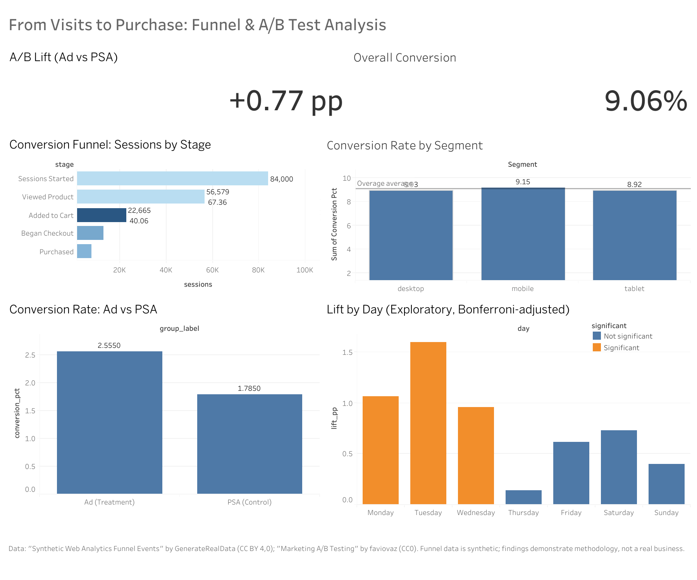

# From Visits to Purchases: Marketing Funnel & A/B Test Analysis

An end-to-end analytics project that (1) diagnoses where visitors drop off in an e-commerce funnel and (2) tests whether an ad campaign actually lifts conversions. The analysis covers SQL, Python, statistical testing, and an interactive Tableau dashboard.



**Interactive dashboard:** [View on Tableau Public](https://public.tableau.com/views/ab-test-funnel/Dashboard?:language=en-US&:sid=&:redirect=auth&:display_count=n&:origin=viz_share_link)

## Business Questions

1. At which stage of the funnel do visitors drop off the most, and do any segments (device, traffic source, month) behave differently?
2. Did the ad campaign increase conversions compared with a control group, and how much of the success can be attributed to the ads?

## Key Findings

### Funnel analysis (84,000 sessions)

| Stage | Sessions | Continue from previous stage |
|---|---|---|
| Sessions Started | 84,000 | |
| Viewed Product | 56,579 | 67.4% |
| Added to Cart | 22,665 | 40.1% |
| Began Checkout | 12,844 | 56.7% |
| Purchased | 7,609 | 59.2% |

- Overall conversion is **9.06%**.
- The largest drop-off is between **Viewed Product and Added to Cart**: 59.9% of sessions that viewed a product never added anything to the cart.
- Conversion is almost identical across devices (8.92-9.15%), traffic sources (8.68-9.52%), and months (8.88-9.35%). Chi-square tests show no statistically significant difference for any segment (all p > 0.05, Cramér's V < 0.01), and time spent per step is flat (about 39 seconds median). The leak is site-wide, not segment-specific.

### A/B test (588,101 users)

| Group | Users | Conversions | Conversion rate |
|---|---|---|---|
| Ad (treatment) | 564,577 | 14,423 | 2.55% |
| PSA (control) | 23,524 | 420 | 1.79% |

- Absolute lift: **+0.77 percentage points** (95% CI: 0.59 to 0.94 pp); relative lift: **43%**.
- Two-proportion z-test: z = 7.37, p < 0.001.
- About **4,300 conversions (roughly 30% of the ad group's conversions)** are attributable to the ads, assuming the groups were randomized as described by the dataset.
- The test is well powered: the observed effect is about 3x the minimum detectable effect (about 0.26 pp).
- Exploratory: after Bonferroni correction, lift is significant on Monday, Tuesday, and Wednesday (strongest on Tuesday, about 1.6 pp) and not significant on the other days.

## Recommendations

1. **Prioritize the product page to cart step.** It is the largest drop-off and affects every segment, so the fix should be site-wide (for example, clearer pricing, stock, or add-to-cart prompts) rather than targeted at one device or channel.
2. **Validate that change with an A/B test** before a full rollout, using a balanced split (for example 50/50). Roughly 63,000 users per group are enough to detect a move from 1.79% to 2.00% at 80% power.
3. **Keep the ad campaign running, and explore weekday timing.** The ads produced a clear lift. The weekday pattern is exploratory and should be confirmed with a dedicated experiment before budgets are shifted.

## Methodology

1. **Funnel analysis (SQL on SQLite):** unique sessions per stage using `COUNT(DISTINCT session_id)`, step conversion and drop-off rates.
2. **Segmentation (Python):** funnel and conversion by device, traffic source, and month; chi-square tests of independence with Cramér's V as effect size.
3. **A/B test (Python, statsmodels):** covariate balance checks, two-proportion z-test, confidence intervals, relative lift, power analysis, and Bonferroni-corrected segment comparison.
4. **Dashboard (Tableau Public):** funnel, KPIs, segment comparison, A/B result, and lift by day.

## Limitations

- The funnel dataset is **synthetic**. The analysis demonstrates methodology and does not describe a real business.
- The funnel dataset has no experiment group, so the A/B test uses a separate dataset. The two datasets are combined only as one illustrative story.
- The A/B dataset is highly imbalanced (96% ad, 4% PSA). Covariate balance on `most_ads_day` and `most_ads_hour` is statistically imperfect (Cramér's V about 0.02, a small effect), and these variables are measured after exposure.
- There is no revenue or cost data, so ROI cannot be computed from the data.
- `total_ads`, day, and hour are measured after randomization, so analyses by those variables are exploratory and not causal.

## Project Structure

```
ab-test-funnel-marketing/
├── notebooks/
│   ├── 01_funnel_eda.ipynb          # Data checks and funnel analysis
│   ├── 02_segmentation.ipynb        # Segment comparison and chi-square tests
│   ├── 03_ab_test.ipynb             # A/B test, power analysis, attribution
│   └── 04_export_for_tableau.ipynb  # Aggregated exports for the dashboard
├── dashboard/
│   ├── exports/                     # Aggregated CSVs used by Tableau
│   ├── ab-test-funnel.twbx          # Tableau workbook
│   └── dashboard.png                # Dashboard screenshot
├── sql/
│   └── funnel_by_stage.sql      # Funnel query (unique sessions per stage)
└── README.md
```

## How to Reproduce

1. Clone the repository and create a virtual environment:
   ```
   python -m venv .venv
   .venv\Scripts\activate
   pip install pandas numpy scipy statsmodels matplotlib seaborn ipykernel
   ```
2. Download the datasets (see Data Sources) and place them in a `data/` folder:
   - `web_funnel_events.sqlite`
   - `marketing_AB.csv`
3. Run the notebooks in order (`01` to `04`) in VS Code or Jupyter.

## Data Sources

- **Funnel data:** "Synthetic Web Analytics Funnel Events" by GenerateRealData (https://generaterealdata.com), licensed under [CC BY 4.0](https://creativecommons.org/licenses/by/4.0/). Kaggle: https://www.kaggle.com/datasets/generaterealdata/synthetic-web-analytics-funnel-events
- **A/B test data:** "Marketing A/B Testing" by faviovaz on Kaggle (https://www.kaggle.com/datasets/faviovaz/marketing-ab-testing), released under [CC0 1.0 Public Domain](https://creativecommons.org/publicdomain/zero/1.0/). Attribution is not required but is given for transparency.

The original data was cleaned, joined across tables, and aggregated into funnel and test metrics. The raw data files are not included in this repository.

## Tools

Python (pandas, NumPy, SciPy, statsmodels, matplotlib), SQL (SQLite), Jupyter Notebook, Tableau Public, VS Code, Git/GitHub.

## Author

**Abiyu Raihan Hanif**


Portfolio: [datascienceportfol.io/abiyuraihanhanif](https://datascienceportfol.io/abiyuraihanhanif)